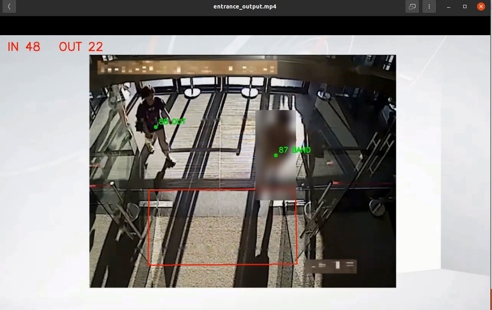
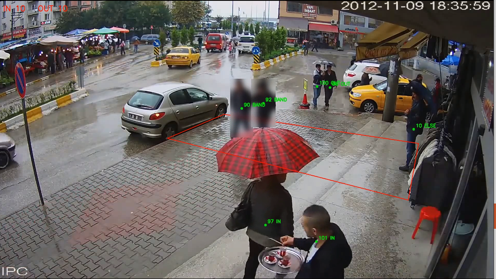

# retail-flow-monitor

Real-time people-flow monitoring from video. This section counts people going
**IN** and **OUT** across a doorway; the queue / counter-zone monitoring lives in
[`queue-count/`](queue-count). Built on YOLO detection + BoT-SORT tracking, and
fully config-driven.

## Download the videos

The sample clips are in a shared Google Drive
[folder](https://drive.google.com/drive/folders/12ac4PAFBlsZxEGsz4ktb5EPAbmBU42kD).
Fetch them into `videos/` with:

```
./download_videos.sh
```

Video sample source:
- `entrance_door` — https://www.youtube.com/watch?v=gmffknydiDI
- `video_playback` — https://www.youtube.com/watch?v=GJNjaRJWVP8

## Running

| Command | Runs |
|---------|------|
| `./run.sh` | `inference.py --video ./videos/entrance_door_cleaned.mp4 --status` (default) |
| `./run.sh --bbox` | default + `--bbox` |
| `./run.sh --video a.mp4` | your own video |

`run.sh` sets up the environment, fetches the weights, checks the lines, then
runs. It writes a per-window CSV of in/out and occupancy.

## Accuracy

Count IN/OUT by hand on a clip and compare with the system. Say how you counted.
(Fill the dashes after labeling; they mark what to measure, not a claimed score.)

| Clip | start | end | hand IN | sys IN | hand OUT | sys OUT | IN error | OUT error |
|------|------:|----:|--------:|-------:|---------:|--------:|---------:|---------:|
| Entrance_door | 0.01 | 2:53 | 50 | 48 | 22 | 22 | 2 | 0 |
| Video_playback | 0.05 | 1.24 | 11 | 10 | 10 | 10 | 1 | 0 |

## Results

Annotated output videos (counting lines, IN/OUT, blurred faces) are in
`results/` after running `./download_videos.sh`:

- `results/entrance_demo_out.mp4`

## Screenshots





## Architecture

Each frame goes through YOLO detection and BoT-SORT tracking. A person is counted
only when they truly cross the finite counting line, which gives the running
IN/OUT totals and the per-window CSV.

Full method and flowchart: [PIPELINE.md](PIPELINE.md).
