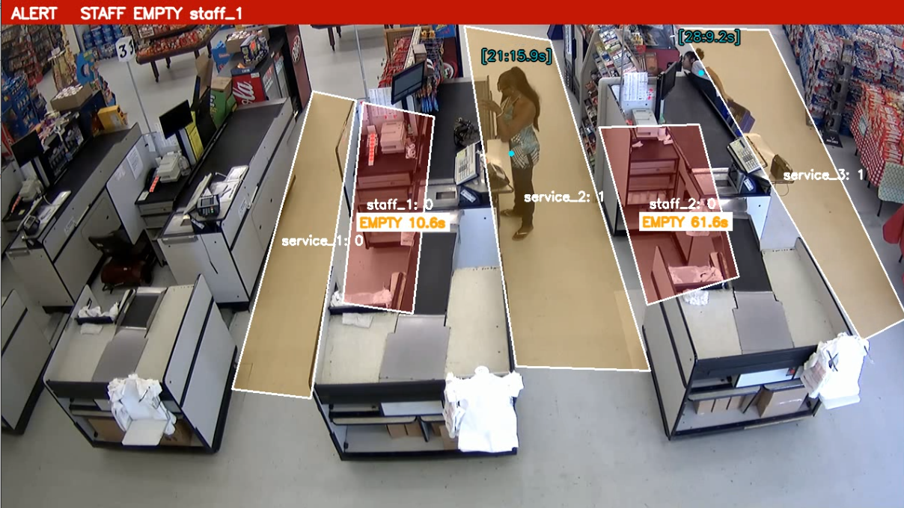
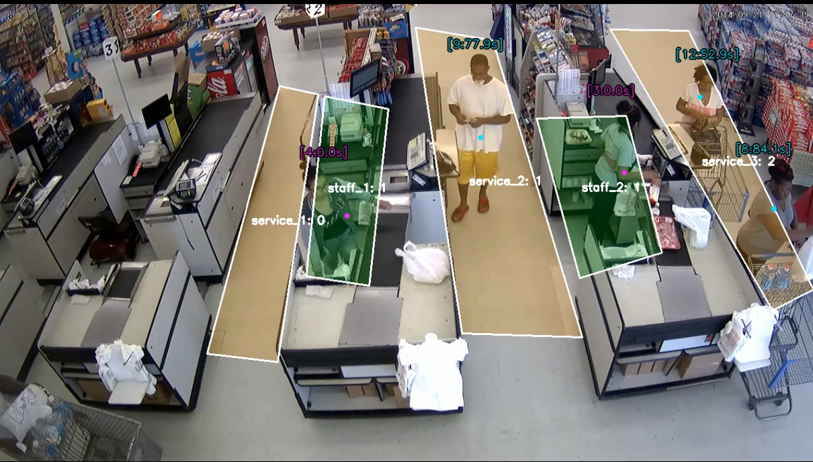

# Queue / Counter Zone Monitoring

Counts how many people wait in each queue zone, checks whether a staff member is
at each counter, and raises queue and empty-counter alerts. Runs one or more
camera sources at once. Built on YOLO detection + BoT-SORT tracking.

## Download the videos

The evaluation clips (and the annotated result videos) are hosted on Google
Drive. Fetch them all with:

```
./download_videos.sh
```

Input clips land in `videos/`, output videos in `results/`.

Video sample source:
- `supermarket_demo` — https://www.youtube.com/watch?v=-8zyEwAa50Q

## Running

| Command | Runs |
|---------|------|
| `./run.sh` | `run.py --video ./videos/supermarket_demo.mp4 --status` (default) |
| `./run.sh --bbox` | default + `--bbox` |
| `./run.sh --video a.mp4 b.mp4` | your sources, multi-stream (exactly like `run.py`) |

`run.sh` sets up the environment, fetches the weights, checks the zones, then
runs. Each source writes its own per-minute CSV and alert-events JSON.

## Accuracy

Clip: `supermarket_demo` (fill the dashes after labeling; they mark what to
measure, not a claimed score). Door IN/OUT accuracy is measured in the
people-counting section, not here.

### Queue occupancy

Hand-label the number of people in each queue zone at these timestamps, read the
system's count (`*_sys`, taken from `run.py` on `supermarket_demo`) at the same
moments, and report the **mean absolute error (MAE)** per zone. The hand counts
were read from the annotated frames in [`measure/`](measure/), one per
timestamp (`30.png`, `60.png`, … `270.png`).

| t (s) | service_1 hand | service_1 sys | service_2 hand | service_2 sys | service_3 hand | service_3 sys |
|------:|---------------:|--------------:|---------------:|--------------:|---------------:|--------------:|
| 30    | 0 | 0 | 0 | 0 | 2 | 2 |
| 60    | 0 | 0 | 0 | 0 | 1 | 1 |
| 90    | 0 | 0 | 1 | 1 | 2 | 2 |
| 120   | 0 | 0 | 1 | 1 | 2 | 2 |
| 150   | 0 | 0 | 2 | 2 | 2 | 2 |
| 180   | 0 | 0 | 1 | 1 | 1 | 1 |
| 210   | 0 | 0 | 0 | 0 | 1 | 1 |
| 240   | 0 | 0 | 1 | 1 | 1 | 1 |
| 270   | 0 | 0 | 0 | 0 | 0 | 0 |
| **MAE** | | 0.00 | | 0.00 | | 0.00 |

### Alerts

List the alerts you expect from the clip by hand, then report how many the
system **found**, **missed**, and **raised wrongly** (false alerts).

| Alert type | Expected (hand) | Found | Missed | False |
|------------|----------------:|------:|-------:|------:|
| queue_alert | 0 | 0 | 0 | 0 |
| empty_counter | 2 | 2 | 0 | 0 |

## Results

Annotated output videos are in `results/` after running `./download_videos.sh`:

- `results/supermarket_demo_out.mp4`
- `results/cctv_demo1_out.mp4`

## Screenshots





## Architecture

Each person is placed in one zone, which gives the per-zone counts, a waiting
timer, the queue and empty-counter alerts, and the per-minute CSV.

Full method and flowchart: [PIPELINE.md](PIPELINE.md)
